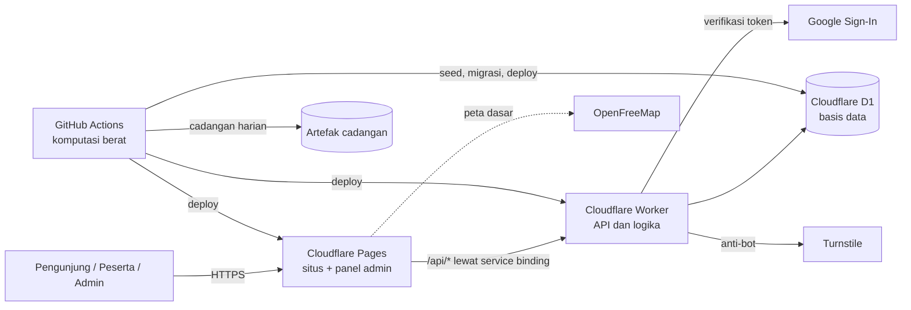

# SIKOP v2, BPS Kabupaten Pesisir Barat

Portal data kewilayahan, data sekolah, layanan permohonan data, dan ruang belajar pembinaan statistik sektoral.
Versi ini dibangun ulang berdasarkan **Laporan Pengujian SIKOP (2 sampai 3 November 2026)**. Status perbaikan
26 temuan ada di [`docs/matriks-temuan.md`](docs/matriks-temuan.md).

## Arsitektur (seluruhnya Rp0)



| Lapisan         | Teknologi                                      | Peran                                                                        |
| --------------- | ---------------------------------------------- | ---------------------------------------------------------------------------- |
| Frontend        | Vite + TypeScript tanpa framework, MapLibre GL | Halaman pengunjung dan panel admin, satu origin                              |
| API             | Cloudflare Workers + Hono + Zod                | Semua logika: penilaian ujian, sertifikat, permohonan, otorisasi             |
| Data            | Cloudflare D1 (SQLite)                         | Sekolah, indikator, LMS, permohonan, audit log                               |
| Komputasi berat | GitHub Actions                                 | Validasi data, penyederhanaan peta, uji titik dalam wilayah, impor, cadangan |

Keputusan arsitektur dijelaskan di [`docs/adr/`](docs/adr/).

## Struktur folder

```
sikop/
  packages/shared/      Logika domain bersama (kecamatan, sekolah, indikator, penilaian, skema validasi)
  apps/api/             Worker API: src/routes, src/services, migrations/, test/
  apps/web/             Situs Pages: halaman per folder (peta/, sekolah/, belajar/, admin/ ...), src/, tests/ (E2E)
  data/raw/             Data sumber: sekolah.csv, batas-kecamatan/*.geojson, podes-<tahun>-kecamatan.csv (agregat)
  data/private/         Berkas per desa (DBF Podes, dll). TIDAK di-commit
  data/reference/       Kode kecamatan, angka lama (draf)
  data/lms/             Contoh bank soal (bank-soal.json asli TIDAK di-commit)
  scripts/              Pipeline data, seed bank soal, pemeriksaan konfigurasi
  docs/                 ADR, runbook, katalog API, matriks temuan
  .github/workflows/    CI, Deploy, Data, Cadangan
```

## Cara paling mudah: satu klik

1. Ekstrak paket ini, lalu letakkan berkas `RAHASIA-bank-soal-kunci-jawaban.json` di folder yang sama dengan
   `PASANG-SIKOP.bat` (atau biarkan di folder Downloads, pemasang akan menemukannya).
2. Klik dua kali **`PASANG-SIKOP.bat`**. Di macOS/Linux jalankan `npm run pasang`.
3. Ikuti tiga momen manual yang diminta: login Cloudflare di browser, membuat Google Client ID (langkah dan
   alamat yang harus ditempel ditampilkan otomatis), serta mengisi email superadmin.

Pemasang membuat basis data D1 dan proyek Pages, menyiapkan tabel, mengisi data sekolah dan bank soal,
memasang rahasia, men-deploy API dan situs, lalu membuka situs yang sudah tayang. Pemasang **dapat dijalankan
ulang**: langkah yang sudah selesai dilewati, dan deploy diulang agar perubahan terbaru ikut terpasang. Gunakan
ini juga untuk memperbarui situs setelah mengubah kode atau data. Rahasia tidak pernah disimpan di komputer.

## Menjalankan di komputer sendiri

Prasyarat: Node.js 22.18 atau lebih baru.

```bash
npm ci
npm run data:build                       # validasi data + build/seed.sql + peta ringan
cp apps/api/.dev.vars.example apps/api/.dev.vars
npm run db:migrate:local
npm run db:seed:local
# Opsional, bank soal asli (berisi kunci, simpan di data/lms/bank-soal.json):
npm run data:lms && (cd apps/api && npx wrangler d1 execute sikop --local --file=../../build/seed-lms.sql)
# Kursus contoh sintetis ("Membaca Data BPS", aman dibagikan; sumber data/lms/kursus-contoh.json):
(cd apps/api && npx wrangler d1 execute sikop --local --file=test/fixtures/seed-lms-contoh.sql)

npm run dev:api     # terminal 1, http://localhost:8787
npm run dev:web     # terminal 2, buka http://localhost:5173
```

Di mode lokal tersedia **login pengembang** (tanpa Google). Email pada `SUPERADMIN_EMAILS` di `.dev.vars`
otomatis menjadi superadmin. Login ini mati sepenuhnya di produksi.

## Pengujian

| Perintah                      | Isi                                                              | Hasil terakhir              |
| ----------------------------- | ---------------------------------------------------------------- | --------------------------- |
| `npm test -w packages/shared` | Unit domain + cakupan (ambang 80%)                               | 72 lulus, cakupan baris 95% |
| `npm test -w apps/api`        | Integrasi Worker + D1 nyata (miniflare)                          | 39 lulus                    |
| `npm run test:e2e`            | Browser: desktop + ponsel, termasuk alur ujian sampai sertifikat | 20 lulus                    |
| `npm run check`               | Lint + tipe + semua uji + build                                  | Hijau                       |

## Deploy pertama kali

1. **Cloudflare**: buat akun, lalu
   ```bash
   cd apps/api
   npx wrangler d1 create sikop          # salin database_id ke apps/api/wrangler.toml
   npx wrangler secret put IP_SALT        # string acak panjang
   npx wrangler secret put SUPERADMIN_EMAILS   # email Google superadmin pertama
   npx wrangler secret put TURNSTILE_SECRET    # dari dasbor Turnstile
   npx wrangler pages project create sikop-pesisirbarat
   ```
2. **Google Sign-In**: di Google Cloud Console buat _OAuth client ID_ jenis Web, isi _Authorized JavaScript
   origins_ dengan domain situs, lalu isi `GOOGLE_CLIENT_ID` di `apps/api/wrangler.toml`.
3. **Turnstile**: buat widget untuk domain situs, isi `TURNSTILE_SITE_KEY` di `apps/api/wrangler.toml`.
4. **Domain**: sesuaikan `ALLOWED_ORIGINS` (wrangler.toml), URL di `public/robots.txt`, `public/sitemap.xml`,
   dan `SIKOP_SITE_URL` (lihat `vite.config.ts`). Untuk domain go.id lihat runbook.
5. **GitHub**: tambahkan _secrets_ `CLOUDFLARE_API_TOKEN` dan `CLOUDFLARE_ACCOUNT_ID`, buat _environment_
   `produksi` dengan _required reviewers_, dan lindungi cabang `main` (wajib PR + CI hijau).
6. Push ke `main`. Workflow **Deploy** menjalankan migrasi, deploy Worker, lalu deploy situs.
7. Jalankan workflow **Data** sekali dengan opsi _impor_ untuk mengisi data sekolah.
8. Seed bank soal dari komputer pengelola: `npm run data:lms`, lalu
   `cd apps/api && npx wrangler d1 execute sikop --remote --file=../../build/seed-lms.sql`.
9. Masuk ke `/admin/` dengan email superadmin, lalu: isi kontak PST, kepanjangan resmi SIKOP, penandatangan
   sertifikat, dan daftarkan admin lain sesuai pemisahan tugas.

## Peta Tematik: satu pintu data visual

SIKOP punya dua menu utama: **Peta Tematik** untuk semua data visual dan **Ruang Belajar** untuk LMS
(ADR-0006). Semua sumber (Dapodik, Podes, dan data tambahan kelak) tampil sebagai indikator yang
dikelompokkan per **tema**, dengan profil kecamatan lintas tema di panel kanan. Data baru cukup
ditambahkan sebagai indikator bertema; tidak perlu menu atau halaman baru.

Data Podes ditampilkan sebagai **agregat kecamatan saja** (ADR-0005). Berkas DBF per desa diletakkan di
`data/private/podes/` lalu diolah dengan `npm run data:podes`; hanya CSV agregat di `data/raw/` yang
di-commit. Langkah lengkap ada di runbook bagian 11.

## Pemeliharaan rutin

Lihat [`docs/runbook.md`](docs/runbook.md): pembaruan data sekolah per semester, pergantian penandatangan,
rotasi bank soal bila bocor, pemulihan cadangan, peninjauan hak akses triwulanan, dan penanganan insiden.

## Kontribusi

Semua aturan kerja, untuk manusia maupun asisten AI (Claude, Gemini, dan lainnya), ada di
[`AGENTS.md`](AGENTS.md). `CLAUDE.md` dan `GEMINI.md` hanya mengimpor berkas itu. Cara mendelegasikan
pekerjaan ke staf, termasuk kartu tugas dan pengaturan GitHub, ada di
[`docs/panduan-delegasi.md`](docs/panduan-delegasi.md).

Ringkasnya: cabang `feat/`, `fix/`, `docs/`, `chore/`, atau `data/`; pesan commit mengikuti Conventional
Commits; setiap PR memakai templat di `.github/pull_request_template.md` dan wajib lolos `npm run check`
(termasuk `scripts/cek-pagar.mjs`). Nama variabel dan fungsi berbahasa Indonesia mengikuti kode yang ada;
dokumentasi dan antarmuka berbahasa Indonesia formal.
